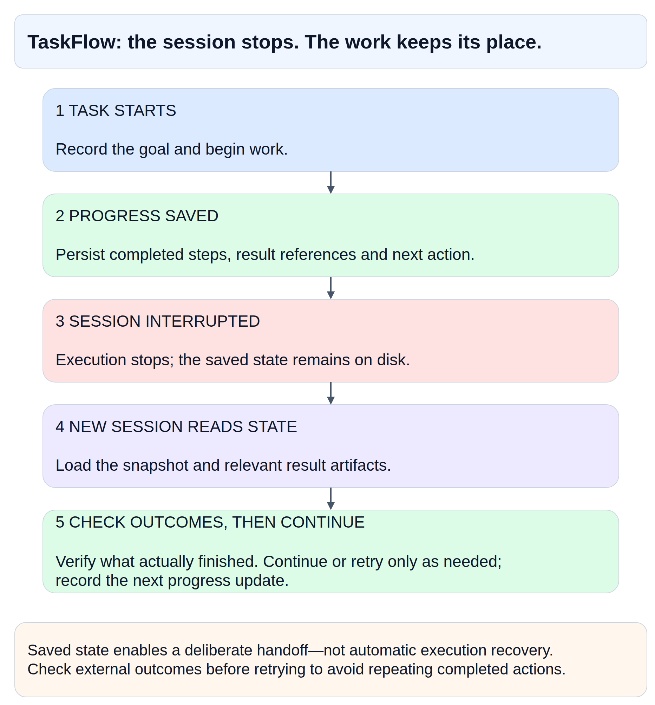

# AI Agent TaskFlow

**Durable task state for long-running AI agents. Survives session restarts, needs no database, and runs on one box.**

I run two AI agents on one small Linux server.
Their sessions get recycled twice a day, and long jobs kept losing their place.
To fix that, I started writing task state out to plain JSON files.
A watcher script checks those files every 2 minutes and posts progress updates to Telegram.

## One task, two sessions



Saved state preserves the handoff between sessions. When a new session starts, it checks existing artifacts and decides what to do next.

## The problem

Agent sessions drop unexpectedly. An agent might run across several sessions, delegate work to a child process, or pause while waiting for input. Chat history is an awkward place to track what is finished, what is blocked, and what needs doing next. Setting up a database or a message broker is usually overkill for a single machine running a couple of personal agents.

## The idea

Store task state outside the model session in a local file. Update that file as work progresses, and read it from an independent process to keep yourself informed.

- Each flow gets a single JSON document that records its goal, status, revision number, and child tasks.
- A CLI tool validates and serialises writes to the document.
- A coordinator session manages the flow, while child workers post their results back through the same tool.
- A polling watcher checks the latest file revision against the last revision it successfully reported.
- When a session restarts, the replacement session reads the unfinished file and resumes the task.

## Benefits

- A replacement session picks up goals, blockers, and next steps directly from disk.
- You can see current status without prompting the agent for updates.
- Everything runs locally without a database or a message broker.
- Plain JSON files are straightforward to inspect, back up, and diff with standard Unix tools.
- Explicit parent and child task entries clarify ownership and artifact locations.
- Loading a compact state snapshot uses fewer tokens than replaying an entire conversation history.
- The watcher sends updates even when the agent session is idle or stopped.
- Revision coalescing stops chat channels from getting flooded with minor status noise.
- The file layout works with different model runtimes and notification channels.

## Architecture

```text
Human request
     |
     v
Owner agent/session -------> Optional child worker
     |                            |
     +-------- updates/results ---+
     |
     v
Validated CLI mutation interface
     |
     v
Flow JSON snapshots <---------- New session reads open work
     |
     | periodically read
     v
Notification watcher <------ Delivery cursor / last reported revision
     |
     v
Human-facing status channel

Terminal flow -> archive -> retained for final notification / inspection
```

The watcher only observes and reports. It does not execute tasks or manage model fallbacks.

## Illustrative state

```json
{
  "schema_version": 1,
  "id": "flow-example-001",
  "goal": "Compare three data-platform architecture options",
  "status": "running",
  "revision": 4,
  "owner": "architecture-session",
  "updated_at": "2026-09-06T10:00:00Z",
  "progress": "Requirements captured; comparison in progress",
  "next_action": "Review child findings and draft a recommendation",
  "children": [
    {
      "id": "task-001",
      "goal": "Compare operating constraints",
      "status": "done",
      "result_ref": "artifacts/constraints.md"
    },
    {
      "id": "task-002",
      "goal": "Assess integration options",
      "status": "running"
    }
  ]
}
```

Child tasks form a simple hierarchy. If you need complex dependency graphs with cycle detection, you must define and check those dependencies explicitly.

## Lifecycle

Tasks move through five states: `pending`, `running`, `waiting`, `done`, and `failed`.

- Create the file with the initial goal before starting work.
- Increment the revision and update the next action on every meaningful step.
- Mark a task as waiting alongside the reason and the condition required to resume.
- Record result references on completion, or failure details and salvageable work on failure.
- Move finished files out of the active directory into an archive folder.

## Notification reconciliation

A timer triggers the watcher every 2 minutes. Setting a minimum gap of 110 seconds between edits to a status message prevents notification spam.

The watcher compares the current revision number in the file with a separate delivery cursor. When it finds a newer revision, it sends or updates the status message and stores the new cursor. If several revisions occur between polling ticks, they coalesce into a single notification.

To ensure terminal statuses are delivered, the watcher scans active files as well as newly archived files whose final revision has not yet been acknowledged. A local file lock prevents multiple watcher runs from overlapping.

## Persistence and recovery

Files only survive if they were flushed to disk before a crash. A saved snapshot tells a new session where the previous run stopped, but it cannot restore an interrupted process or in-flight network call.

When resuming, the agent checks running tasks against actual disk artifacts before deciding whether to continue or rerun a step.

- Write changes to a temporary file first, then atomically replace the target file on the same filesystem.
- Call filesystem sync functions if you require durability against host power cuts.
- Use file locking to serialise concurrent reads and writes.
- Validate JSON against a schema and keep corrupted files aside for inspection.
- Store notification delivery cursors separately from task data.
- Keep regular backups of task directories.

## Limits

TaskFlow is deliberately narrow in scope:

- It is not a distributed task queue or a worker lease system.
- It does not provide durable execution or deterministic replay.
- It does not guarantee exactly-once execution or notification delivery.
- It does not handle automated DAG scheduling, dependency resolution, or distributed transactions.

## Where it fits

- Personal or small-team agent setups on a single host.
- Extended research, writing, and architecture reviews that span several sessions.
- Tasks where inspectable local files matter more than distributed orchestration.
- Workflows where a human or an agent coordinator can inspect results and handle restarts manually.

## Similar ideas

- [Kubernetes controllers](https://kubernetes.io/docs/concepts/architecture/controller/)
- [Temporal Workflow Execution](https://docs.temporal.io/workflow-execution)

## Open design questions

- How should ownership transfer between sessions be recorded?
- When should stale tasks be flagged, and who decides whether to retry?
- How much event history is worth retaining alongside snapshots?
- Which minimal fields enable portable handoffs between agent runtimes?
- When does operational complexity justify migration to a workflow engine?
